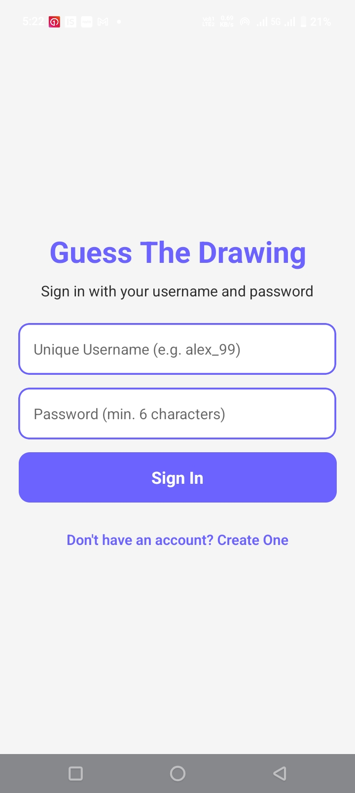
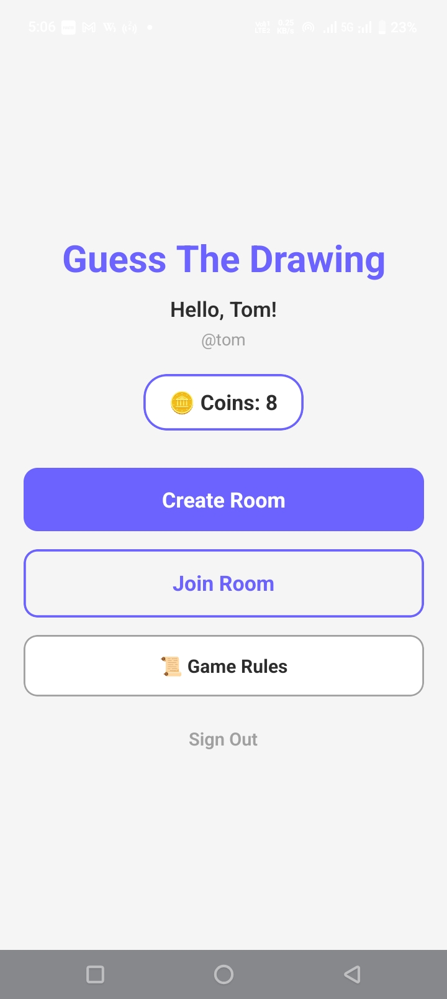
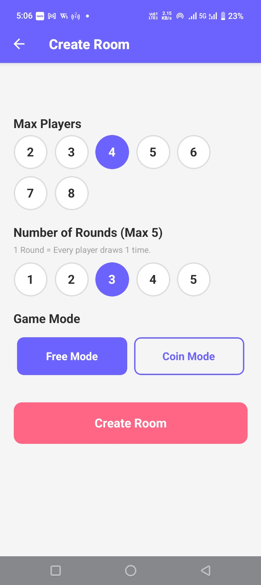
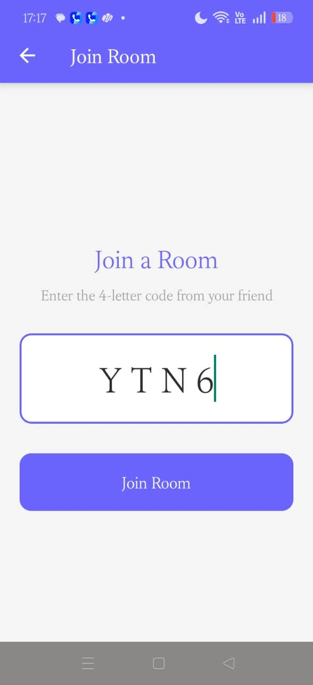
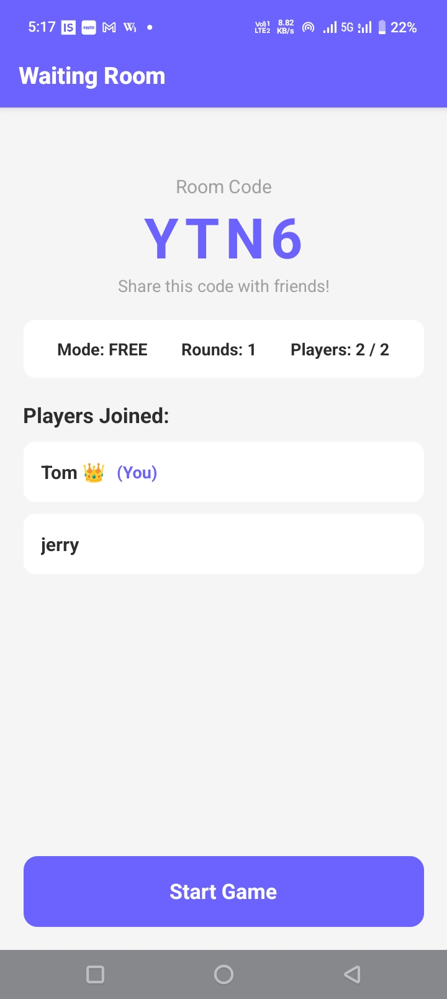
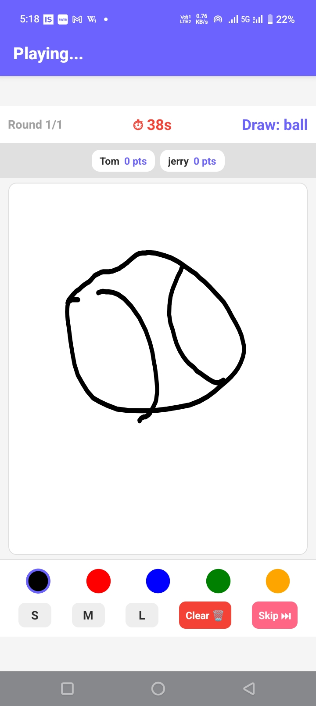
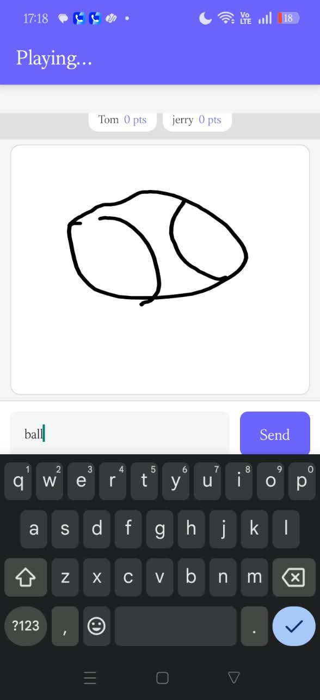
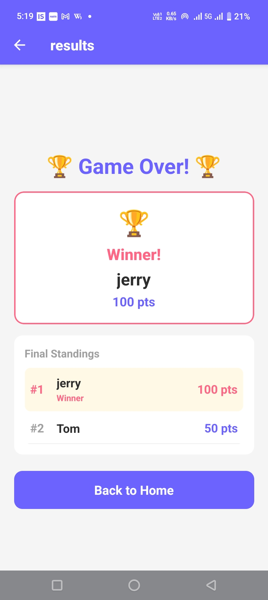
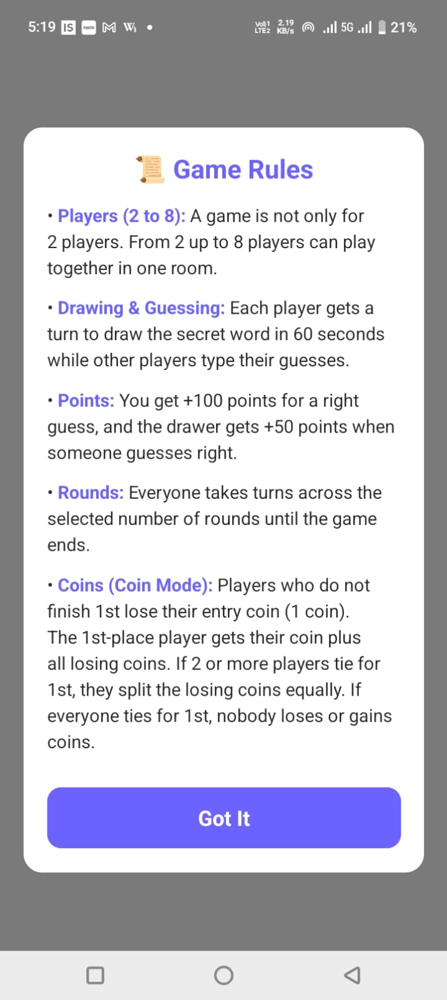

# 🎨 GuessTheDrawing

### Draw • Guess • Compete • Win!

GuessTheDrawing is a real-time multiplayer drawing and guessing game built with **React Native, Expo, and Firebase**. Players can create private game rooms, invite friends, take turns drawing secret words, and compete to earn the highest score.

With live drawing synchronization, interactive gameplay, and a virtual coin-based competition system, the game brings a fun multiplayer experience to mobile devices.

---

## 📸 Screenshots

### Login & Home

<p align="center">
  
  
</p>

### Room Management

<p align="center">
  
  
  
</p>

### Gameplay

<p align="center">
  
  
</p>

### Results & Instructions

<p align="center">
  
  
</p>

---

## ✨ Key Features

### 👤 User Authentication

- User registration with display name, unique username, and password.
- Login using username and password.
- Unique username validation to prevent duplicate accounts.
- Persistent authentication sessions across app restarts.
- Individual player profiles and virtual coin balances.

### 🏠 Multiplayer Rooms

- Create and join rooms using unique 4-character room codes.
- Support for 2–8 players per room.
- Configurable game rounds and game modes.
- Host-controlled game starting.
- Real-time player information and room synchronization.

### 🎨 Interactive Drawing

- Real-time drawing synchronization across connected devices.
- Multiple brush colors: Black, Red, Blue, Green, and Orange.
- Three brush sizes: Small, Medium, and Large.
- Clear canvas and skip-turn options.
- Responsive drawing canvas that adapts to different screen sizes.

### 💬 Guessing System

- Players guess the secret word while another player draws.
- Case-insensitive answer validation.
- Instant feedback for correct and incorrect guesses.
- Players who guess correctly cannot submit another guess in the same turn.
- Automatic turn progression when everyone guesses correctly.

### 🏆 Scoring & Competition

- 100 points for a correct guess.
- 50 points for the active drawer when someone guesses correctly.
- 60-second drawing timer.
- Multiple rounds with rotating drawing turns.
- Final leaderboard with player rankings.
- Winner and draw detection, including tied scores.

### 🪙 Virtual Coin System

- Initial virtual coin balance for registered players.
- Optional coin-based game mode.
- Entry cost of 1 virtual coin per player.
- Winners receive a share of the coins collected from losing players.
- Automatic draw handling when all players finish with equal scores.
- Match results and coin transaction records.

---

## 🎮 How to Play

1. Register or log in to your account.
2. Create a room or join an existing room using its code.
3. Wait for at least one other player to join.
4. The host starts the game.
5. Players take turns drawing secret words.
6. Other players try to guess the drawing before the timer expires.
7. Earn points for correct guesses and successful drawings.
8. Continue through the configured rounds.
9. View the final leaderboard and match results.

### Scoring Rules

| Action | Points |
|---|---:|
| Correct Guess | +100 |
| Successful Drawing | +50 |

---

## 🛠️ Technology Stack

| Category | Technologies |
|---|---|
| Mobile Development | React Native |
| Framework | Expo |
| Navigation | Expo Router |
| Programming Language | JavaScript (ES6+) |
| Authentication | Firebase Authentication |
| Real-Time Database | Firebase Realtime Database |
| Drawing & Graphics | React Native SVG |
| Touch Interaction | PanResponder |
| Session Persistence | AsyncStorage |

---

## 🏗️ Application Architecture

The application follows a service-based architecture with separate responsibilities for authentication, game management, and drawing synchronization.

### Main Components

- `app/` – Application screens and navigation.
- `hooks/` – Authentication and user state management.
- `services/` – Firebase integration and game-related operations.
- `utils/` – Game constants and word selection utilities.

### Core Services

- **Authentication Service:** User registration, login, and username management.
- **Room Service:** Room creation, joining, scoring, turn progression, and coin payouts.
- **Drawing Service:** Drawing stroke synchronization and canvas management.

### 🔄 Real-Time Multiplayer Architecture

Firebase Realtime Database keeps connected players synchronized during gameplay.

The application uses real-time listeners to update:

- Room status and game progress.
- Player scores and turn information.
- Drawing strokes on the shared canvas.
- Guessing status and final results.
- Player coin balances.

This allows multiple players using different devices to participate in the same game room.

---

## 🔐 Security Considerations

- Passwords are handled through Firebase Authentication rather than stored in the player database.
- Usernames are reserved using Firebase transactions to prevent duplicate registrations.
- Firebase Realtime Database security rules should be configured to restrict unauthorized access.
- Server-side validation for competitive coin transactions is planned as a future enhancement.

---

## 🚀 Future Enhancements

- **🔐 Secure Coin Transactions:** Implement Firebase Cloud Functions for secure coin transactions and reward validation.
- **🔄 Player Disconnection Handling:** Improve room management with automatic reconnection and recovery during active matches.
- **👥 Friends & Social Features:** Add friend lists, invitations, and private multiplayer challenges.
- **💬 Live Chat & Reactions:** Enable real-time messaging and fun emoji reactions so players can interact while playing.

## 📱 Platform Support

| Platform | Status |
|---|---|
| Android | APK build available |
| iOS | Future platform support |
| Web | Future platform support |

---

## 👨‍💻 Developer

**Pavan Kumar Y**

GitHub: [@pavannkumar1000](https://github.com/pavannkumar1000)

---

## ⚙️ Installation & Setup

### Prerequisites

Make sure you have the following installed:

- Node.js and npm
- Expo CLI / EAS CLI
- Android device or Android Emulator
- Firebase account

### 1. Clone the Repository

```bash
git clone https://github.com/pavannkumar1000/GuessTheDrawing.git
cd GuessTheDrawing
```

### 2. Install Dependencies

```bash
npm install
```

### 3. Configure Firebase

Create a Firebase project and configure:

- Firebase Authentication
- Firebase Realtime Database

Add your Firebase configuration to the project's Firebase initialization file.

### 4. Start the Application

```bash
npx expo start
```

Scan the QR code using Expo Go or run the application on an Android emulator.

## 📥 Download APK

Experience GuessTheDrawing on your Android device.

<p align="center">
  <a href="https://expo.dev/accounts/pavannkumar1000/projects/guessthedrawing/builds/fe61bcb9-0993-4fb1-85a1-0806deaf8014">
    <strong>📲 Download GuessTheDrawing APK</strong>
  </a>
</p>